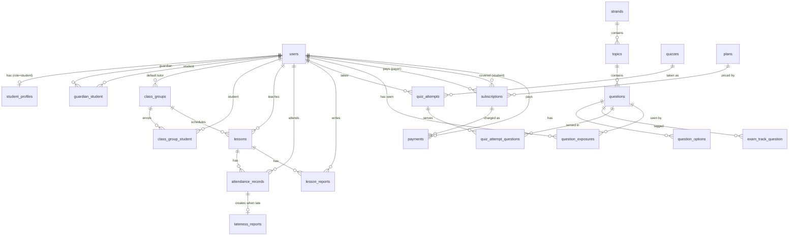

# Backend / Database Schema

Target: Laravel 13, SQLite locally and MySQL/Postgres in production. Enumerated columns are `string` columns cast to PHP backed enums (in `app/Enums`), not database ENUMs, so adding a value later doesn't need a migration.

## 1. Entity overview



## 2. Enums (`app/Enums`)

| Enum                 | Values                                                  |
| -------------------- | ------------------------------------------------------- |
| `Role`               | `Admin`, `Tutor`, `Student`, `Guardian`                 |
| `AttendeeRole`       | `Student`, `Tutor`                                      |
| `AttendanceStatus`   | `Present`, `Late`, `Absent`, `Excused`                  |
| `LessonStatus`       | `Scheduled`, `InProgress`, `Completed`, `Cancelled`     |
| `KeyStage`           | `Ks2`, `Ks3`, `Ks4` (GCSE)                              |
| `Difficulty`         | `Easy`, `Intermediate`, `Hard`, `Challenging`           |
| `ExamTrack`          | `ElevenPlus`, `Sats`, `Gcse`                            |
| `QuestionType`       | `MultipleChoice`, `MultiSelect`, `Numeric`, `ShortText` |
| `QuestionStatus`     | `Draft`, `InReview`, `Published`, `Retired`             |
| `QuizAttemptStatus`  | `InProgress`, `Submitted`, `Abandoned`                  |
| `PaymentGatewayName` | `Paystack`, `Flutterwave`                               |
| `SubscriptionStatus` | `Pending`, `Active`, `PastDue`, `Cancelled`, `Expired`  |
| `PaymentStatus`      | `Pending`, `Succeeded`, `Failed`, `Refunded`            |

**Year group → difficulty** (this rule lives in `YearGroup::defaultDifficulty()`, so it isn't duplicated anywhere else):

| Year           | Key stage | Default difficulty               |
| -------------- | --------- | -------------------------------- |
| 3, 4           | KS2       | Easy                             |
| 5              | KS2       | Intermediate                     |
| 6              | KS2       | Hard                             |
| 7              | KS3       | Easy                             |
| 8              | KS3       | Intermediate                     |
| 9              | KS3       | Hard                             |
| KS3 extra tier | KS3       | Challenging (opt-in or unlocked) |
| 10, 11         | KS4       | via `ExamTrack::Gcse`            |

## 3. Module 0: Accounts

### `users` (extends the default migration)

| Column                                                   | Type            | Notes       |
| -------------------------------------------------------- | --------------- | ----------- |
| id                                                       | bigint PK       |             |
| name, email, password, remember_token, email_verified_at | default         |             |
| role                                                     | string, indexed | `Role` enum |
| phone                                                    | string null     |             |
| timestamps, softDeletes                                  |                 |             |

### `student_profiles`

| Column                    | Type                      | Notes          |
| ------------------------- | ------------------------- | -------------- |
| id                        | PK                        |                |
| user_id                   | FK users, unique, cascade |                |
| year_group                | unsignedTinyInteger       | 3–11           |
| date_of_birth             | date null                 |                |
| school_name               | string null               |                |
| challenging_tier_unlocked | boolean default false     | KS3 extra tier |
| timestamps                |                           |                |

### `guardian_student`

| Column       | Type        | Notes                        |
| ------------ | ----------- | ---------------------------- |
| guardian_id  | FK users    |                              |
| student_id   | FK users    |                              |
| relationship | string null | e.g. "Mother"                |
| timestamps   |             | PK (guardian_id, student_id) |

## 4. Module 1: Attendance & Punctuality

`class` is a reserved word in PHP, so a recurring class is a **ClassGroup** and each dated occurrence of it is a **Lesson**.

### `class_groups`

| Column           | Type                 | Notes                     |
| ---------------- | -------------------- | ------------------------- |
| id               | PK                   |                           |
| name             | string               | "Year 5 Maths – Saturday" |
| tutor_id         | FK users null        | default tutor             |
| year_group       | tinyint null         |                           |
| location         | string null          | room or meeting link      |
| weekday          | tinyint null         | ISO 1–7 (Monday = 1)      |
| start_time       | time null            |                           |
| duration_minutes | smallint default 60  |                           |
| is_active        | boolean default true |                           |
| timestamps       |                      |                           |

### `class_group_student` (enrolments)

`class_group_id` FK, `student_id` FK users, `enrolled_at` date, `left_at` date null, timestamps. Unique on (class_group_id, student_id).

### `lessons`

| Column           | Type              | Notes                                                             |
| ---------------- | ----------------- | ----------------------------------------------------------------- |
| id               | PK                |                                                                   |
| class_group_id   | FK class_groups   |                                                                   |
| tutor_id         | FK users          | the tutor scheduled for _this_ lesson (can cover for the default) |
| starts_at        | datetime, indexed | scheduled start, the punctuality baseline                         |
| ends_at          | datetime          |                                                                   |
| status           | string            | `LessonStatus`                                                    |
| cancelled_reason | string null       |                                                                   |
| timestamps       |                   |                                                                   |

### `attendance_records`

One row per person per lesson. The tutor gets a row too, with the same table and the same rules.

| Column         | Type                | Notes                                                          |
| -------------- | ------------------- | -------------------------------------------------------------- |
| id             | PK                  |                                                                |
| lesson_id      | FK lessons, cascade |                                                                |
| user_id        | FK users            |                                                                |
| attendee_role  | string              | `AttendeeRole`                                                 |
| status         | string              | `AttendanceStatus`                                             |
| arrived_at     | datetime null       |                                                                |
| minutes_late   | smallint null       | computed on save from `arrived_at − lessons.starts_at`         |
| recorded_by_id | FK users            | tutor (register), the tutor themselves (check-in), or an admin |
| notes          | text null           |                                                                |
| timestamps     |                     |                                                                |
|                |                     | **unique (lesson_id, user_id)**; index (user_id, status)       |

**Rule:** status is `Late` when `minutes_late > config('academy.lateness_grace_minutes')` (default 0, admin-configurable later).

### `lateness_reports`

Created automatically (in an `AttendanceRecord` model event or a `RecordAttendance` action) whenever a record becomes `Late`. Its fields are _snapshots_, so the history stays accurate even if the lesson is later rescheduled.

| Column               | Type                | Notes                    |
| -------------------- | ------------------- | ------------------------ |
| id                   | PK                  |                          |
| attendance_record_id | FK, unique, cascade |                          |
| user_id              | FK users, indexed   | who was late             |
| attendee_role        | string              | student / tutor          |
| lesson_id            | FK lessons          | which class              |
| class_name           | string              | snapshot                 |
| lesson_date          | date, indexed       |                          |
| scheduled_start_at   | datetime            | snapshot                 |
| arrived_at           | datetime            |                          |
| minutes_late         | smallint            |                          |
| reason               | text null           | given by the late person |
| reviewed_by_id       | FK users null       | admin follow-up          |
| reviewed_at          | datetime null       |                          |
| follow_up_notes      | text null           |                          |
| timestamps           |                     |                          |

If the record is later corrected to _not late_, its report is deleted. If the arrival time changes, the report is updated.

### `lesson_reports` (end-of-class reports)

| Column          | Type                | Notes                                                      |
| --------------- | ------------------- | ---------------------------------------------------------- |
| id              | PK                  |                                                            |
| lesson_id       | FK lessons, cascade |                                                            |
| author_id       | FK users            |                                                            |
| author_role     | string              | `AttendeeRole`, so tutor and student have the same ability |
| rating          | tinyint null        | 1–5                                                        |
| went_well       | text null           |                                                            |
| issues          | text null           |                                                            |
| recommendations | text null           |                                                            |
| submitted_at    | datetime            |                                                            |
| timestamps      |                     | **unique (lesson_id, author_id)**                          |

## 5. Module 2: Maths Quiz Platform

### `strands`

`id`, `name` (Number, Algebra, Statistics, Geometry), `slug` unique, `sort_order`. Seeded.

### `topics`

| Column      | Type       | Notes                        |
| ----------- | ---------- | ---------------------------- |
| id          | PK         |                              |
| strand_id   | FK strands |                              |
| key_stage   | string     | `KeyStage`                   |
| name, slug  | string     | slug is unique per key stage |
| description | text null  |                              |
| sort_order  | smallint   |                              |

e.g. KS2 Number has _Place value, Addition & subtraction, Multiplication & division, Fractions, Decimals & percentages_, and so on, following the National Curriculum.

### `questions`

| Column                      | Type                    | Notes                                             |
| --------------------------- | ----------------------- | ------------------------------------------------- |
| id                          | PK                      |                                                   |
| topic_id                    | FK topics, indexed      |                                                   |
| difficulty                  | string, indexed         | `Difficulty`                                      |
| year_group                  | tinyint null, indexed   | null = applies to the whole key stage             |
| type                        | string                  | `QuestionType`                                    |
| stem                        | text                    | Markdown + KaTeX (`$\frac{3}{4}$`)                |
| image_path                  | string null             | diagrams for geometry and statistics              |
| numeric_answer              | decimal(12,4) null      | for `Numeric`                                     |
| numeric_tolerance           | decimal(12,4) default 0 |                                                   |
| accepted_answers            | json null               | for `ShortText`, case-insensitive matches         |
| explanation                 | text null               | worked solution shown after answering             |
| marks                       | tinyint default 1       |                                                   |
| status                      | string, indexed         | `QuestionStatus`; only `Published` is ever served |
| author_id, reviewed_by_id   | FK users null           |                                                   |
| published_at                | datetime null           |                                                   |
| times_served, times_correct | unsigned int default 0  | for quality analytics                             |
| timestamps, softDeletes     |                         |                                                   |
|                             |                         | composite index (topic_id, difficulty, status)    |

### `question_options`

`id`, `question_id` FK cascade, `body` text, `is_correct` bool, `sort_order`. Used by `MultipleChoice` and `MultiSelect`.

### `exam_track_question`

`question_id` FK, `exam_track` string (`ExamTrack`). PK (question_id, exam_track). A single question can be in both Year 6 _Hard_ and the _SATs_ track.

### `quizzes` (a quiz is a recipe; its questions are drawn from the bank)

| Column             | Type               | Notes                |
| ------------------ | ------------------ | -------------------- |
| id                 | PK                 |                      |
| title, slug        | string             |                      |
| key_stage          | string null        |                      |
| year_group         | tinyint null       |                      |
| exam_track         | string null        |                      |
| difficulty         | string null        |                      |
| strand_id          | FK null            | null = mixed strands |
| topic_id           | FK null            | null = mixed topics  |
| question_count     | tinyint default 10 |                      |
| time_limit_seconds | int null           | null = untimed       |
| is_published       | boolean            |                      |
| timestamps         |                    |                      |

### `quiz_attempts`

`id`, `user_id` FK, `quiz_id` FK, `status` (`QuizAttemptStatus`), `started_at`, `submitted_at` null, `score` null, `max_score`, `duration_seconds` null, timestamps. Index on (user_id, quiz_id).

### `quiz_attempt_questions`

| Column          | Type              | Notes                                   |
| --------------- | ----------------- | --------------------------------------- |
| id              | PK                |                                         |
| quiz_attempt_id | FK cascade        |                                         |
| question_id     | FK                |                                         |
| position        | tinyint           |                                         |
| response        | json null         | raw answer (option ids, number or text) |
| is_correct      | boolean null      |                                         |
| marks_awarded   | tinyint default 0 |                                         |
| answered_at     | datetime null     |                                         |
|                 |                   | unique (quiz_attempt_id, question_id)   |

### `question_exposures` (makes "no repeats" cheap)

`user_id` FK, `question_id` FK, `times_seen` int, `last_seen_at` datetime, `last_correct` bool null. PK (user_id, question_id); index (user_id, last_seen_at).

**Selection algorithm** (`QuestionPicker` service):

1. Filter to `Published` questions matching the quiz recipe (topic/strand, difficulty, year group, or exam track).
2. Take the questions the student has **never seen** (anti-join on `question_exposures`), shuffle, and use up to `question_count`.
3. If the pool runs short, top up with the **least recently seen** questions, preferring ones answered wrongly.
4. Upsert the exposures when the attempt starts.
5. Admin dashboard: flag any recipe whose unseen pool is below 3× `question_count` for its active students, so the bank can be grown before repeats happen.

## 6. Module 3: Subscriptions (Paystack + Flutterwave)

Both gateways are supported through one `PaymentGateway` contract. The active one for **new** checkouts is chosen by `config('payments.default')` (`paystack` or `flutterwave`). Every subscription records which gateway it belongs to, so renewals, cancellations and webhooks always go back to the gateway that created it, even after the default is switched.

**Currency: Nigerian naira (NGN) only.** Amounts are stored as integer **kobo** (₦1 = 100 kobo) everywhere in our database. Each driver converts at its edge: Paystack takes kobo as-is, while **Flutterwave v3 takes naira**, so the driver sends `amount / 100` and converts the webhook and verify amounts back to kobo.

**API versions are pinned:** the Paystack REST API (`https://api.paystack.co`, which has a single stable version) and **Flutterwave v3** (`https://api.flutterwave.com/v3`), the stable, generally available version. Newer Flutterwave API versions are out of scope until they're stable and we choose to migrate.

Neither gateway does per-seat quantities on a recurring plan. So the model is **one subscription per covered student**: a guardian with two children has two subscriptions, both paid by the same payer. No Cashier, and no gateway SDKs: the drivers call the REST APIs with Laravel's `Http` client.

### `plans`

| Column              | Type                | Notes                                                  |
| ------------------- | ------------------- | ------------------------------------------------------ |
| id                  | PK                  |                                                        |
| name, slug          | string              | "Quiz Access – Monthly"                                |
| amount              | unsignedInteger     | **kobo**; must equal the dashboard plan's amount       |
| currency            | string(3)           | always `NGN`                                           |
| interval            | string              | `monthly`                                              |
| paystack_plan_code  | string null, unique | `PLN_xxx`, copied from the Paystack dashboard          |
| flutterwave_plan_id | string null, unique | payment plan id, copied from the Flutterwave dashboard |
| is_active           | boolean             |                                                        |
| timestamps          |                     |                                                        |

**Plans are created in the gateway dashboards, never by our code.** For each gateway, the admin creates a monthly NGN plan in its dashboard (Paystack → _Plans_; Flutterwave → _Payment plans_), then pastes the code or id into **Admin → Billing settings**.

- On save, the app fetches the plan (`GET /plan/{code}` on Paystack, `GET /payment-plans/{id}` on Flutterwave) and **rejects** it unless the amount, the currency (`NGN`) and the interval (`monthly`) match the local `plans` row, and the plan is active.
- A gateway can't be the default in `PAYMENT_GATEWAY` until its plan is linked. The billing page and checkout show "Payments unavailable" rather than erroring.
- For local and test environments, `PlanSeeder` reads `PAYSTACK_PLAN_CODE` and `FLUTTERWAVE_PLAN_ID` from `.env` (sandbox plans).
- To change the price: create a new plan in the dashboard, then link it. Existing subscribers stay on their old plan code until they resubscribe.

### `subscriptions`

| Column                    | Type                   | Notes                                                                                                   |
| ------------------------- | ---------------------- | ------------------------------------------------------------------------------------------------------- |
| id                        | PK                     |                                                                                                         |
| payer_id                  | FK users               | guardian, or the student paying for themselves                                                          |
| student_id                | FK users, indexed      | who gets access                                                                                         |
| plan_id                   | FK plans               |                                                                                                         |
| gateway                   | string                 | `PaymentGatewayName` enum: `Paystack`, `Flutterwave`                                                    |
| gateway_customer_code     | string null            | Paystack `CUS_xxx` / Flutterwave customer id                                                            |
| gateway_subscription_code | string null, indexed   | Paystack `SUB_xxx` / Flutterwave subscription id                                                        |
| gateway_email_token       | string null, encrypted | Paystack only: required to disable a subscription                                                       |
| status                    | string, indexed        | `SubscriptionStatus`: `Pending`, `Active`, `PastDue`, `Cancelled`, `Expired`                            |
| current_period_ends_at    | datetime null          | access runs until this date (+ grace)                                                                   |
| cancel_at_period_end      | boolean default false  | the user cancelled; keep access until the period ends                                                   |
| cancelled_at              | datetime null          |                                                                                                         |
| timestamps                |                        |                                                                                                         |
|                           |                        | index (student_id, status); at most one non-final subscription per student, enforced in `StartCheckout` |

### `payments` (every charge, initial and renewal)

| Column                 | Type                  | Notes                                                                       |
| ---------------------- | --------------------- | --------------------------------------------------------------------------- |
| id                     | PK                    |                                                                             |
| subscription_id        | FK subscriptions null |                                                                             |
| payer_id               | FK users              |                                                                             |
| gateway                | string                |                                                                             |
| reference              | string, **unique**    | our reference (`JGA-<ulid>`), sent to the gateway as `reference` / `tx_ref` |
| gateway_transaction_id | string null           | Paystack transaction id / Flutterwave `transaction_id`                      |
| amount                 | unsignedInteger       | kobo                                                                        |
| currency               | string(3)             |                                                                             |
| status                 | string                | `PaymentStatus`: `Pending`, `Succeeded`, `Failed`, `Refunded`               |
| paid_at                | datetime null         |                                                                             |
| gateway_response       | json null             | the verified payload, for support and disputes                              |
| timestamps             |                       |                                                                             |

### `webhook_events` (idempotency + audit)

`id`, `gateway`, `event_key` (string; the gateway's event id or a hash of the body), `type` (e.g. `charge.success`), `payload` json, `processed_at` null, `error` text null, timestamps. **Unique (gateway, event_key)**, so a duplicate delivery is a no-op.

### Gateway contract (`app/Payments`)

```php
interface PaymentGateway
{
    /** Create a hosted checkout for the plan; returns the redirect URL and our reference. */
    public function startCheckout(Plan $plan, User $payer, User $student, string $reference, string $callbackUrl): CheckoutSession;

    /** Server-side verification of a transaction by our reference. Never trust the redirect query string alone. */
    public function verify(string $reference): VerifiedPayment;

    /** Stop future renewals at the gateway. */
    public function cancel(Subscription $subscription): void;

    /** Check the signature and turn the raw webhook into a normalised event, or null if it's irrelevant. */
    public function parseWebhook(Request $request): ?GatewayEvent;
}
```

`GatewayEvent` is a small readonly DTO: `type` (`PaymentSucceeded`, `PaymentFailed`, `SubscriptionCreated`, `SubscriptionCancelled`), `eventKey`, `reference`, `subscriptionCode`, `customerCode`, `amount`, `currency`, `periodEndsAt`, `raw`. A single `ApplyGatewayEvent` action updates `payments` and `subscriptions` from it, whichever gateway sent it.

`PaymentGatewayManager` (extends `Illuminate\Support\Manager`) resolves `paystack` → `PaystackGateway` and `flutterwave` → `FlutterwaveGateway`. Call `driver()` for new checkouts, and `driver($subscription->gateway->value)` for existing subscriptions.

### Gateway mapping

| Concern          | Paystack                                                                                                                                | Flutterwave (v3 API)                                                                                                              |
| ---------------- | --------------------------------------------------------------------------------------------------------------------------------------- | --------------------------------------------------------------------------------------------------------------------------------- |
| Recurring plan   | Plan (`plan_code`), monthly interval                                                                                                    | Payment plan (`payment_plan` id), monthly interval                                                                                |
| Start checkout   | `POST /transaction/initialize` with `email`, `amount`, `plan`, `reference`, `callback_url`, `metadata.student_id` → `authorization_url` | `POST /payments` with `tx_ref`, `amount`, `currency`, `payment_plan`, `redirect_url`, `customer`, `meta.student_id` → `data.link` |
| Verify           | `GET /transaction/verify/{reference}`                                                                                                   | `GET /transactions/verify_by_reference?tx_ref={reference}`                                                                        |
| Webhook auth     | `x-paystack-signature` = HMAC-SHA512 of the raw body with the secret key                                                                | `verif-hash` header equals the secret hash set in the dashboard                                                                   |
| Events we handle | `charge.success`, `subscription.create`, `invoice.payment_failed`, `subscription.not_renew`, `subscription.disable`                     | `charge.completed` (success/failed); subscription state fetched from `GET /subscriptions?email=`                                  |
| Cancel           | `POST /subscription/disable` with `code` + `email_token`                                                                                | `PUT /subscriptions/{id}/cancel`                                                                                                  |
| Manage card      | `GET /subscription/{code}/manage/link`                                                                                                  | none: cancel and resubscribe                                                                                                      |

The Flutterwave column is the **v3** API throughout; don't mix in endpoints from newer versions. The plan lookups used by Billing settings are `GET /plan/{code}` (Paystack) and `GET /payment-plans/{id}` (Flutterwave v3).

### Flow

1. The guardian picks a child, then **Subscribe** → `StartCheckout` creates a `Pending` subscription and payment with a fresh reference, and redirects to the gateway's hosted page.
2. The gateway redirects back to `/billing/callback/{gateway}` → `verify(reference)` on the **server**. If it succeeded, the payment becomes `Succeeded`, the subscription becomes `Active`, and `current_period_ends_at` is now + 1 month.
3. Webhooks at `/webhooks/paystack` and `/webhooks/flutterwave` (no CSRF, rate-limited) record the event in `webhook_events`, then `ApplyGatewayEvent` runs on a queue. A renewal extends `current_period_ends_at`; a failure sets the status to `PastDue`; a cancellation sets `cancel_at_period_end`.
4. The `subscriptions:expire` command (scheduled hourly) moves anything past `current_period_ends_at + grace` to `Expired`.

The callback and the webhook can arrive in either order, or both at once. Every update is keyed on the unique `reference`, so applying it twice is harmless.

**Access rule** (`User::hasQuizAccess()`, enforced by the `EnsureQuizAccess` middleware):
`role = Admin|Tutor` **or** the student has a subscription with status `Active|PastDue` and `current_period_ends_at + config('payments.grace_days') > now()`. Access is only ever granted from server-verified payments.

## 7. Config

`config/academy.php`

```php
return [
    'lateness_grace_minutes' => env('ACADEMY_LATENESS_GRACE_MINUTES', 0),
    'quiz_default_question_count' => 10,
];
```

`config/payments.php`

```php
return [
    'default' => env('PAYMENT_GATEWAY', 'paystack'),
    'grace_days' => env('PAYMENT_GRACE_DAYS', 3),
    'currency' => 'NGN',

    'paystack' => [
        'public_key' => env('PAYSTACK_PUBLIC_KEY'),
        'secret_key' => env('PAYSTACK_SECRET_KEY'),
        'base_url' => 'https://api.paystack.co',
        'plan_code' => env('PAYSTACK_PLAN_CODE'), // local/test seeding only
    ],

    'flutterwave' => [
        'public_key' => env('FLUTTERWAVE_PUBLIC_KEY'),
        'secret_key' => env('FLUTTERWAVE_SECRET_KEY'),
        'webhook_hash' => env('FLUTTERWAVE_WEBHOOK_HASH'),
        'base_url' => 'https://api.flutterwave.com/v3', // pinned to v3
        'plan_id' => env('FLUTTERWAVE_PLAN_ID'), // local/test seeding only
    ],
];
```
